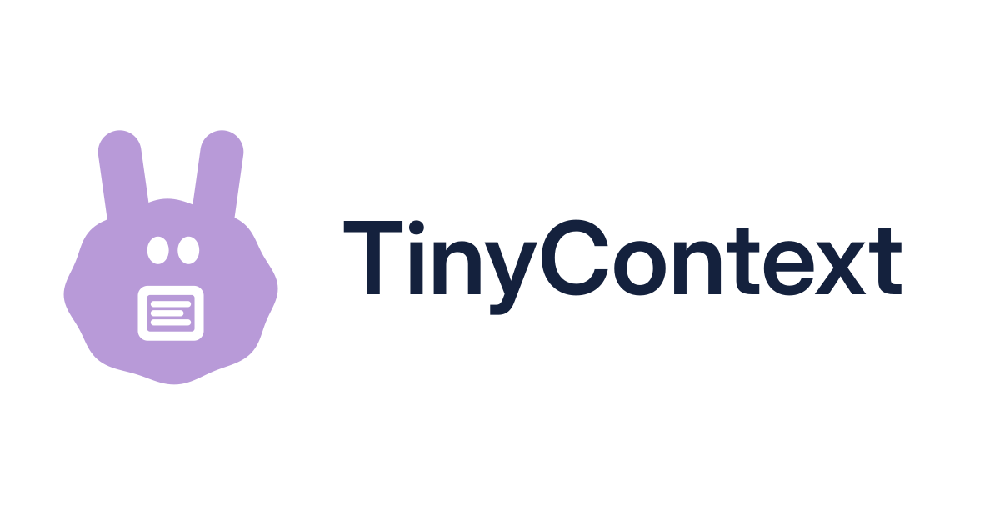

<!-- mcp-name: io.github.TinySuiteHQ/tinycontext -->

<div align="center">

# TinyContext

<a href="https://tinysuite.dev">
  
</a>

**Context that fits your local LLMs.**

Part of [TinySuite](https://tinysuite.dev). Comes built in to [TinyWebUI](https://github.com/TinySuiteHQ/TinyWebUI), and works with any MCP client.

[](https://tinysuite.dev)
[](https://pypi.org/project/tinysuite-context/)
[](https://pepy.tech/projects/tinysuite-context)
[](https://github.com/TinySuiteHQ/TinyContext/actions/workflows/ci.yml)
[](LICENSE)
[](pyproject.toml)
[](https://github.com/TinySuiteHQ/TinyContext/releases)
[](https://github.com/TinySuiteHQ/TinyContext/commits/main)
[](https://hub.docker.com/r/marcellm01/tinycontext)
[](https://discord.gg/mFFKF9bf5e)


**[Read the documentation → tinysuite.dev/docs/tinycontext](https://tinysuite.dev/docs/tinycontext/)**

</div>

---

TinyContext is the memory layer of [TinySuite](https://tinysuite.dev), a set of small, local-first tools that make agents spend tokens on useful work rather than overhead. It stores concise memories and their embeddings in SQLite, ranks them with hybrid BM25 and dense retrieval, and returns only the context that fits the requested token budget, so an agent recalls a small, ranked set of memories instead of resending its history.

No hosted account. No giant context dumps. No required vector database. Against an agent that resends every stored memory, recall used 96.7% fewer tokens, with p95 latency around 12 ms at 20,000 memories ([docs/benchmarks.md](docs/benchmarks.md)).

## Highlights

- **No vendor in the loop.** No account, no required API key, no per-request billing, no hosted memory service. Memories stay in a SQLite file you own.
- **Recall that fits the budget.** Ranking and token trimming happen locally, so only the memories that fit reach the model.
- **No required vector database.** Embeddings and BM25 live in the same SQLite row; `sqlite-vec` handles similarity.
- **Profile memories.** Durable facts such as what to call the user ride along with every recall, under their own small budget.
- **Six small MCP tools.** Save, recall (by meaning or most recent first), list, get, update and delete, with short stable `ref`s for corrections.
- **Self-maintaining.** Near-duplicates are skipped at save time, and changing the embedding model re-embeds the store in the background.
- **Multi-user when hosted.** Behind a trusted proxy, each user gets a separate SQLite store, checked on every message.
- **Works where agents already work.** MCP over stdio or Streamable HTTP, Python, FastAPI, or Docker. Local ONNX embeddings are the default.

## Quick start

| Tier | Use it when | Entry point |
| --- | --- | --- |
| Python library | You are building an agent or Python application | `pip install tinysuite-context` |
| One-command MCP | An MCP client should launch TinyContext for you | `uvx --python 3.12 --from "tinysuite-context[server]" tinycontext` |
| Docker | You want persistent self-hosted storage and HTTP MCP | `docker compose ... up -d` ([Docker](https://tinysuite.dev/docs/tinycontext/#docker-and-http-mcp)) |

With [`uv`](https://docs.astral.sh/uv/) installed, add TinyContext to any stdio MCP client:

```json
{
  "mcpServers": {
    "tinycontext": {
      "command": "uvx",
      "args": ["--python", "3.12", "--from", "tinysuite-context[server]", "tinycontext"]
    }
  }
}
```

The no-argument `tinycontext` command runs stdio MCP. On its first launch, TinyContext downloads the selected ONNX embedding bundle into its per-user data directory. The database is created lazily on the first save or recall. Later launches reuse both local assets.

Check the resolved configuration and storage readiness with:

```bash
uvx --python 3.12 --from "tinysuite-context[server]" tinycontext doctor
```

From Python, `pip install tinysuite-context` and call `save_memories` and `recall_memories` directly ([Python library](https://tinysuite.dev/docs/tinycontext/#python-library)). MCP, FastAPI and Docker are adapters around that same engine.

## Documentation

The full reference lives at **[tinysuite.dev/docs/tinycontext](https://tinysuite.dev/docs/tinycontext/)**:

| Topic | Covers |
| --- | --- |
| [Quick start](https://tinysuite.dev/docs/tinycontext/#quick-start) | MCP over stdio |
| [Installation](https://tinysuite.dev/docs/tinycontext/#choose-an-installation) | Python, uvx, Docker |
| [Docker and HTTP MCP](https://tinysuite.dev/docs/tinycontext/#docker-and-http-mcp) | The published image, local builds, the FastAPI profile |
| [Hosted multi-user](https://tinysuite.dev/docs/tinycontext/#hosted-multi-user) | The trusted proxy and per-user stores |
| [Management views](https://tinysuite.dev/docs/tinycontext/#management) | Browsing and editing memories from a client UI |
| [Python library](https://tinysuite.dev/docs/tinycontext/#python-library) | The engine, its config and results |
| [MCP tools](https://tinysuite.dev/docs/tinycontext/#mcp-tools) | The six tools, profile memories, what recall returns |
| [How recall works](https://tinysuite.dev/docs/tinycontext/#how-recall-works) | Hybrid ranking and the token budget |
| [FastAPI](https://tinysuite.dev/docs/tinycontext/#fastapi) | The HTTP API and its error codes |
| [OpenTelemetry](https://tinysuite.dev/docs/tinycontext/#opentelemetry) | Traces and metrics |
| [Configuration](https://tinysuite.dev/docs/tinycontext/#configuration) | Every setting and environment variable |
| [Benchmarks](https://tinysuite.dev/docs/tinycontext/#benchmarks) | Speed, token savings and accuracy |
| [Troubleshooting](https://tinysuite.dev/docs/tinycontext/#troubleshooting) | `tinycontext doctor` and common problems |
| [Development and security](https://tinysuite.dev/docs/tinycontext/#development-and-security) | Working from a checkout, entrypoints, release signing |

In this repository: [docs/benchmarks.md](docs/benchmarks.md) is the full benchmark write-up, with how it compares to published Mem0 and Zep numbers and the scripts to rerun every figure, and [configs/context_config.json](configs/context_config.json) is an example configuration.

## Development

```bash
git clone https://github.com/TinySuiteHQ/TinyContext
cd TinyContext
python -m venv .venv
source .venv/bin/activate
pip install -e ".[server]"
python -m unittest discover tests
python scripts/smoke_mcp_stdio.py
```

TinyContext supports Python 3.12 and newer. CI tests Python 3.12, 3.13, and 3.14 across Linux, macOS, and Windows.

Release images are scanned with Trivy, run as a non-root user, and signed with Cosign. [SECURITY.md](SECURITY.md) has the details and how to report a vulnerability; [SUPPORT.md](SUPPORT.md) is the support policy.

Questions, ideas, and bug reports are welcome on [Discord](https://discord.gg/mFFKF9bf5e) or in [GitHub issues](https://github.com/TinySuiteHQ/TinyContext/issues).

## License

TinyContext is built and maintained from Vienna, Austria: useful software, small enough to understand, and maintained long enough to rely on. Release history is on the [Releases](https://github.com/TinySuiteHQ/TinyContext/releases) page.

MIT. See [LICENSE](LICENSE) and [NOTICE](NOTICE).
